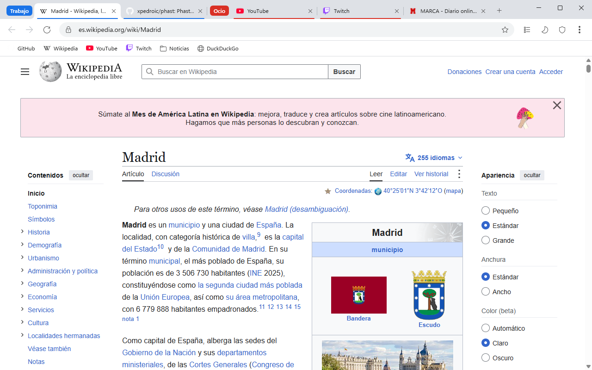
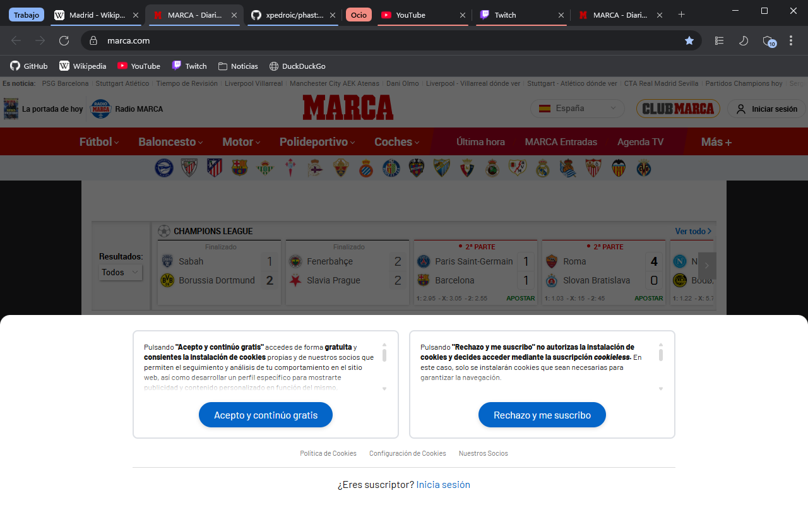
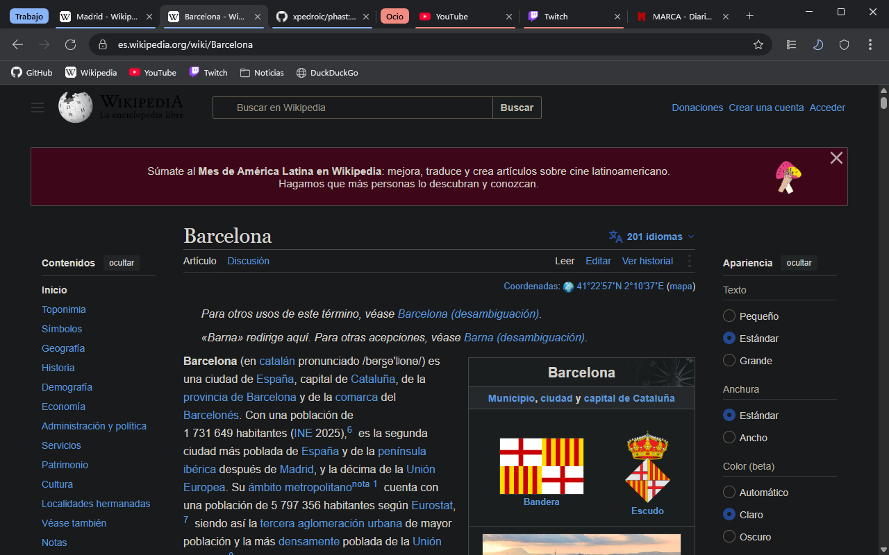
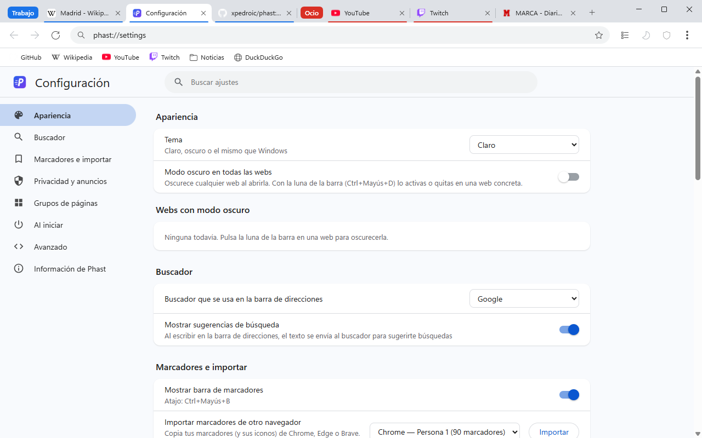
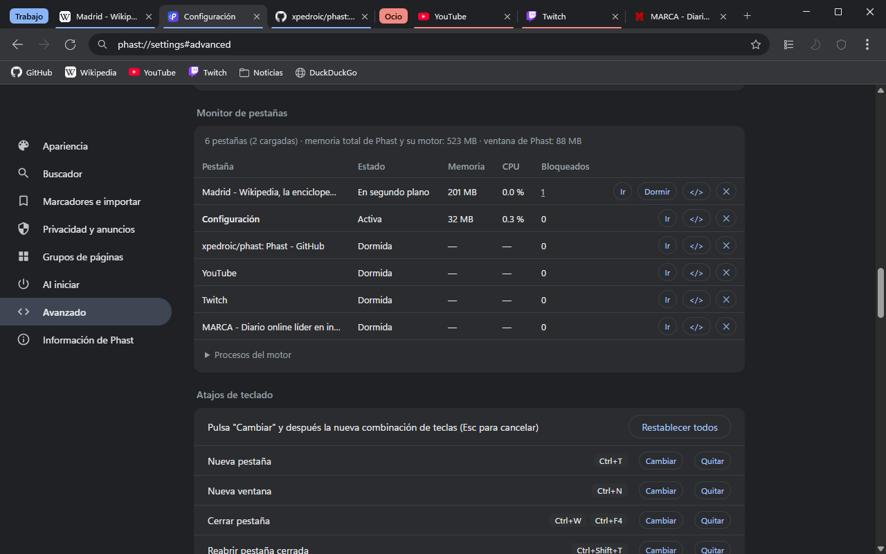

# Phast

**Phast: a fast, simple and hackable web browser for Windows.**

[Español](#español) · [English](#english)

---

## Español

### ¿Qué es Phast?

Phast es un navegador web para Windows 10/11 pensado para ser **rápido, ligero y fácil de usar**, con el aspecto y el orden de Google Chrome. Usa el motor WebView2 que ya viene con Windows (el mismo motor que Chromium/Edge), así que las páginas se ven igual que en Chrome, pero la "carcasa" es mucho más pequeña.

Lo que lo hace especial:

- **Consume poco**: las pestañas en segundo plano se duermen solas y las pestañas restauradas no se cargan hasta que las abres.
- **Bloqueador de anuncios integrado**, activado desde el primer momento.
- **Modo oscuro instantáneo** para cualquier web y bloqueo de anuncios de **YouTube y Twitch** integrado.
- **Grupos de páginas**: abre "Trabajo" u "Ocio" con un clic.
- **Importa tus marcadores de Chrome** con un clic.
- **Modo desarrollador** en los ajustes: atajos, rendimiento, filtros, CSS/JS por sitio, flags del motor… todo desde la interfaz, sin tocar archivos de configuración.

### Capturas



| | |
|---|---|
|  |  |
| *Bloqueador de anuncios integrado, tema oscuro* | *Modo oscuro instantáneo (Ctrl+Mayús+D)* |
|  |  |
| *Ajustes (phast://settings)* | *Modo desarrollador: monitor de pestañas* |

### Rendimiento

Medido el 20/10/2026 en el mismo PC con Windows 11, cada navegador con un perfil nuevo y sin extensiones (Phast 0.1.0, Chrome 155, Edge 155). Media de 3 arranques en vacío y 2 arranques abriendo las mismas 5 webs (Wikipedia, GitHub, Marca, YouTube y Reddit), midiendo 25 s después. Memoria y CPU = suma de todos los procesos de cada navegador.

| | Phast | Chrome | Edge |
|---|---|---|---|
| **Arranque en vacío**: ventana visible | 1,0 s | **0,6 s** | 1,1 s |
| **Arranque en vacío**: memoria privada | **203 MB** | 310 MB | 409 MB |
| **Arranque en vacío**: CPU usada | **6 s** | 11 s | 20 s |
| **5 webs**: memoria privada | **~900 MB** | ~1.000 MB | ~900 MB |
| **5 webs**: memoria en uso (working set) | **1.420 MB** | 1.670 MB | 1.490 MB |
| **5 webs**: CPU usada | **47 s** | 56 s | 54 s |

En resumen: Phast arranca usando **un 35 % menos de memoria y casi la mitad de CPU que Chrome**, y con páginas abiertas gasta menos que Chrome gracias al bloqueador de anuncios integrado. Chrome sigue mostrando su ventana algo antes (unos 0,4 s). Además, Phast duerme las pestañas que no usas, así que con el tiempo la diferencia crece.

### Descargar

1. Ve a la página de [Releases](https://github.com/xpedroic/phast/releases).
2. Descarga el archivo `Phast-vX.Y.Z-win-x64.zip` de la última versión.
3. Descomprímelo donde quieras y abre `Phast.exe`. No hace falta instalar nada.

Necesitas el **WebView2 Runtime**, que ya viene incluido en Windows 11 (y en casi todos los Windows 10 actualizados).

### Compilar desde el código

Requisitos: Windows 10/11 y el [.NET 8 SDK](https://dotnet.microsoft.com/download/dotnet/8.0).

```bat
git clone https://github.com/xpedroic/phast.git
cd phast
build.bat
```

El ejecutable listo para usar queda en la carpeta `dist`. Para desarrollo también puedes usar `dotnet run --project src/Phast`.

### Contribuir

¡Las mejoras son bienvenidas! Lee [CONTRIBUTING.md](CONTRIBUTING.md).

### Licencia

Phast usa la licencia [PolyForm Noncommercial 1.0.0](LICENSE). Explicado de forma sencilla:

- ✅ Phast es **gratis para todo el mundo**.
- ✅ Cualquiera puede **usarlo, compilarlo, modificarlo y hacer forks**.
- ❌ **Nadie puede venderlo ni usarlo con fines comerciales.**
- ℹ️ Los forks deben usar **un nombre distinto de "Phast"**, para que nadie los confunda con el proyecto original.

Phast incluye componentes de terceros con sus propias licencias: consulta [THIRD_PARTY_NOTICES.md](THIRD_PARTY_NOTICES.md).

---

## English

### What is Phast?

Phast is a web browser for Windows 10/11 designed to be **fast, lightweight and easy to use**, with the look and layout of Google Chrome. It uses the WebView2 engine that already ships with Windows (the same Chromium engine used by Edge), so pages render just like in Chrome, while the browser "shell" stays small.

Highlights:

- **Low resource usage**: background tabs go to sleep automatically and restored tabs are not loaded until you open them.
- **Built-in ad blocker**, on by default.
- **Instant dark mode** for any website, and built-in **YouTube and Twitch ad blocking**.
- **Page groups**: open "Work" or "Fun" with a single click.
- **One-click import of your Chrome bookmarks.**
- **Developer mode** in Settings: shortcuts, performance, filter lists, per-site CSS/JS, engine flags… all from the UI, no config files to edit.

### Screenshots


| | |
|---|---|
|  |  |
| *Built-in ad blocker, dark theme* | *Instant dark mode (Ctrl+Shift+D)* |
|  |  |
| *Settings (phast://settings)* | *Developer mode: tab monitor* |

### Performance

Measured on 2026-10-20 on the same Windows 11 PC, every browser with a fresh profile and no extensions (Phast 0.1.0, Chrome 155, Edge 155). Average of 3 empty starts and 2 starts opening the same 5 sites (Wikipedia, GitHub, Marca, YouTube and Reddit), measured after 25 s. Memory and CPU = sum of all the browser's processes.

| | Phast | Chrome | Edge |
|---|---|---|---|
| **Empty start**: window visible | 1.0 s | **0.6 s** | 1.1 s |
| **Empty start**: private memory | **203 MB** | 310 MB | 409 MB |
| **Empty start**: CPU used | **6 s** | 11 s | 20 s |
| **5 sites**: private memory | **~900 MB** | ~1,000 MB | ~900 MB |
| **5 sites**: memory in use (working set) | **1,420 MB** | 1,670 MB | 1,490 MB |
| **5 sites**: CPU used | **47 s** | 56 s | 54 s |

In short: Phast starts with **35% less memory and about half the CPU of Chrome**, and with pages open it uses less than Chrome thanks to the built-in ad blocker. Chrome still shows its window slightly sooner (~0.4 s). Phast also puts unused tabs to sleep, so the gap grows over time.

### Download

1. Go to the [Releases](https://github.com/xpedroic/phast/releases) page.
2. Download `Phast-vX.Y.Z-win-x64.zip` from the latest release.
3. Unzip it anywhere and run `Phast.exe`. No installation needed.

You need the **WebView2 Runtime**, which is already included in Windows 11 (and in almost every up-to-date Windows 10).

### Build from source

Requirements: Windows 10/11 and the [.NET 8 SDK](https://dotnet.microsoft.com/download/dotnet/8.0).

```bat
git clone https://github.com/xpedroic/phast.git
cd phast
build.bat
```

The ready-to-use executable ends up in the `dist` folder. For development you can also run `dotnet run --project src/Phast`.

### Contributing

Improvements are welcome! See [CONTRIBUTING.md](CONTRIBUTING.md).

### License

Phast is licensed under [PolyForm Noncommercial 1.0.0](LICENSE). In plain words:

- ✅ Phast is **free for everyone**.
- ✅ Anyone can **use, build, modify and fork it**.
- ❌ **Nobody may sell it or use it for commercial purposes.**
- ℹ️ Forks must use **a name other than "Phast"**, so nobody confuses them with the original project.

Phast includes third-party components under their own licenses: see [THIRD_PARTY_NOTICES.md](THIRD_PARTY_NOTICES.md).
